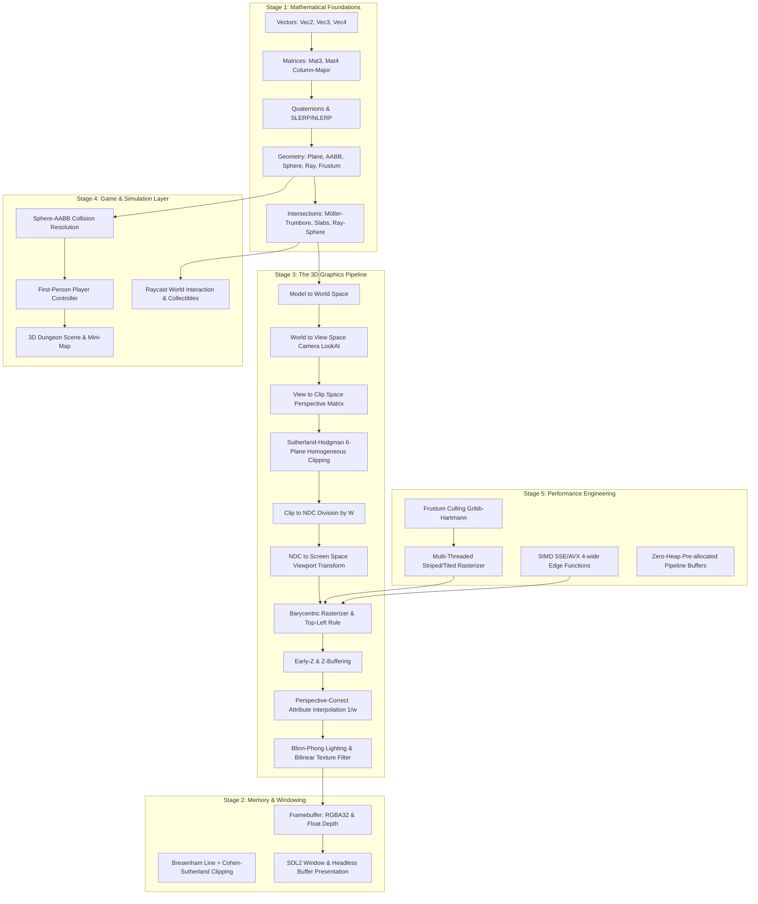

# Prism: System Architecture and Pipeline Design

Prism is a from-scratch C++17 software rasterization engine and 3D graphics pipeline built without any external graphics libraries (no OpenGL, DirectX, Vulkan, GLM, or Eigen). It implements the complete mathematical and hardware-level emulation of a modern graphics processing unit.

---

## 1. The Explicit Coordinate Space Pipeline

A core architectural principle in Prism is **type safety across coordinate systems**. Rather than passing raw `Vec4` instances between stages where mistakes can go unnoticed, each coordinate system is formalized as a distinct type:

1. **Model Space**: Local object coordinates (e.g. unit cube corners $[-0.5, +0.5]$).
2. **World Space**: Transformed by affine model matrix $M = T \cdot R \cdot S$.
3. **View (Camera) Space**: Transformed by $V = \text{LookAt}(\text{eye}, \text{target}, \text{up})$.
4. **Clip Space (Homogeneous)**: Transformed by perspective projection matrix $P$. A point is inside the viewing frustum if and only if:
   $$-w \le x \le w, \quad -w \le y \le w, \quad -w \le z \le w$$
5. **Normalized Device Coordinates (NDC)**: Result of perspective division:
   $$\mathbf{x}_{\text{ndc}} = \frac{x_{\text{clip}}}{w_{\text{clip}}}, \quad \mathbf{y}_{\text{ndc}} = \frac{y_{\text{clip}}}{w_{\text{clip}}}, \quad \mathbf{z}_{\text{ndc}} = \frac{z_{\text{clip}}}{w_{\text{clip}}}$$
6. **Screen Space**: Viewport transform to window pixel coordinates:
   $$x_{\text{screen}} = (x_{\text{ndc}} + 1.0) \times 0.5 \times \text{width}, \quad y_{\text{screen}} = (1.0 - y_{\text{ndc}}) \times 0.5 \times \text{height}$$

---

## 2. Sutherland-Hodgman Homogeneous Clipping

Triangles partially outside the frustum cannot simply be discarded—they must be geometrically clipped. Prism implements homogeneous Sutherland-Hodgman clipping against all 6 frustum planes:
- $+X \le W$ (Right), $-X \le W$ (Left)
- $+Y \le W$ (Top), $-Y \le W$ (Bottom)
- $+Z \le W$ (Far), $-Z \le W$ (Near)

Clipping in homogeneous clip space prior to division by $W$ avoids division-by-zero singularities when vertices lie at or behind the camera plane ($W \le 0$).

---

## 3. Perspective-Correct Attribute Interpolation

In screen space, linear interpolation of attributes (such as texture coordinates $(u, v)$ or surface normals $\mathbf{n}$) produces severe affine warping. Prism guarantees perspective correctness by interpolating attribute values weighted by $1/w$:

$$\frac{A(p)}{w(p)} = \lambda_0 \frac{A_0}{w_0} + \lambda_1 \frac{A_1}{w_1} + \lambda_2 \frac{A_2}{w_2}$$
$$\frac{1}{w(p)} = \lambda_0 \frac{1}{w_0} + \lambda_1 \frac{1}{w_1} + \lambda_2 \frac{1}{w_2}$$
$$A(p) = \frac{\frac{A(p)}{w(p)}}{\frac{1}{w(p)}}$$

Where $\lambda_0, \lambda_1, \lambda_2$ are the barycentric coordinates evaluated via edge functions.

---

## 4. Concurrency & Tile Parallelism

The framebuffer is divided into horizontal screen bands. Because each worker thread writes to completely non-overlapping memory ranges of the color buffer and depth buffer, Prism achieves race-free parallel rasterization with zero synchronization locks inside the fragment loop.
